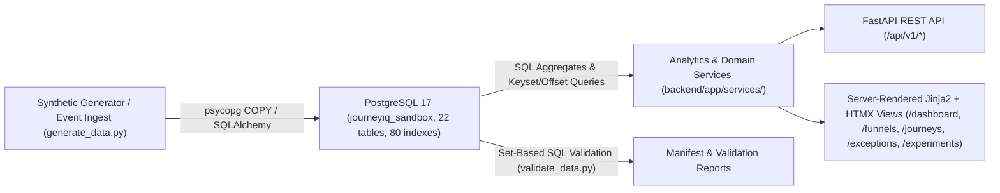

# JourneyIQ — Customer Journey & Conversion Analytics Platform

JourneyIQ is an end-to-end customer journey reconstruction, multi-channel attribution, funnel analytics, experimentation, and data-quality guardrail platform built with **FastAPI**, **Jinja2 + HTMX**, **PostgreSQL 17**, **SQLAlchemy**, and **Alembic**.

---

## Architecture & Tech Stack



- **Backend & Web UI:** FastAPI (`backend/app/main.py`), Jinja2 templates (`backend/app/templates/`), HTMX, and Pydantic Settings (`backend/app/core/config.py`).
- **Database & ORM:** PostgreSQL 17 (`127.0.0.1:5432`), SQLAlchemy 2.x (`psycopg` 3 driver), Alembic migrations (`backend/migrations/`).
- **Analytics & Domain Logic:**
  - `backend/app/services/domain_service.py`: Event ingestion, sessionization, consent-gated identity stitching, authoritative order deduplication, experiment bucketing, and versioned 7-day attribution outcomes.
  - `backend/app/services/analytics_service.py`: SQL-backed KPI dashboard, SQL-joined 5-stage Stage Reach vs. Strict Sequential funnel analytics, paginated journey explorer, bounded exception monitoring, and experiment lift summaries.
- **Documentation:**
  - [Product Requirements (PRD)](docs/PRD.md)
  - [Architecture Overview](docs/ARCHITECTURE.md)
  - [Business Rules](docs/BUSINESS_RULES.md)
  - [Data Dictionary](docs/DATA_DICTIONARY.md)
  - [Design Decisions](docs/DECISIONS.md)
  - [Success Criteria](docs/SUCCESS_CRITERIA.md)

---

## PostgreSQL & Environment Configuration

Runtime database selection is explicit via `RUNTIME_DB_TARGET` in `.env` (copy from [`.env.example`](.env.example)):

| Variable | Purpose | Configured Sandbox / Test Separation |
| --- | --- | --- |
| `RUNTIME_DB_TARGET` | Selects backend runtime target (`sandbox` or `primary`, default `primary`) | Set to `sandbox` in `.env` so Uvicorn connects explicitly to `SANDBOX_DATABASE_URL` |
| `SANDBOX_DATABASE_URL` | Populated full-scale PostgreSQL 17 sandbox | `postgresql+psycopg://postgres:<PW>@127.0.0.1:5432/journeyiq_sandbox` |
| `DATABASE_URL` | Separate primary database URL (`journeyiq`) | Never silently redirected; isolated CLI/tests refuse to touch it |
| `TEST_DATABASE_URL` | Dedicated destructive pytest database (`*test*`) | Enforced isolated from both primary (`journeyiq`) and `journeyiq_sandbox` |
| `JOURNEYIQ_READER_PASSWORD` | Password for read-only verification role (`journeyiq_reader`) | `SELECT`-only access across all 22 tables |

Wait-free credential safety: `backend/app/db/session.py` (`get_runtime_database_info`) and FastAPI startup logs always redact passwords.

---

## Setup & Execution Instructions

### 1. Create Environment Configuration
Copy `.env.example` to `.env` and populate your PostgreSQL 17 credentials (`SANDBOX_DATABASE_URL`, `RUNTIME_DB_TARGET=sandbox`).

### 2. Start the FastAPI + Jinja2/HTMX Server
```powershell
cd c:\CandidateWorkspace\journeyIQ\backend
c:\CandidateWorkspace\journeyIQ\.venv\Scripts\uvicorn.exe app.main:app --host 127.0.0.1 --port 8000
```
Then open:
- Dashboard: `http://127.0.0.1:8000/dashboard`
- Funnels: `http://127.0.0.1:8000/funnels`
- Journeys Explorer: `http://127.0.0.1:8000/journeys` (`3,921` pages at `25` per page; sample hero journey: `/journeys/JRN-HERO-001`)
- Exceptions & Quarantine: `http://127.0.0.1:8000/exceptions`
- Experiments & Lift: `http://127.0.0.1:8000/experiments`
- Health Check JSON: `http://127.0.0.1:8000/api/v1/health`

### 3. Dataset Generation, CSV Export & Validation (Reproducible `seed=42`)
Both [`generate_data.py`](data-generation/generator/generate_data.py) and [`validate_data.py`](data-generation/validation/validate_data.py) require an explicit isolated target (`--db-env-var` or `--database-url`) and explicit `--output-dir`:

```powershell
cd c:\CandidateWorkspace\journeyIQ

# MVP dataset (149 sessions, 510 events)
c:\CandidateWorkspace\journeyIQ\.venv\Scripts\python.exe data-generation\generator\generate_data.py `
  --db-env-var SANDBOX_DATABASE_URL --seed 42 --scale mvp --confirm-reset `
  --output-dir data-generation\sandbox-output\seed-42-mvp

# Full-scale dataset (~2.05M events, chunked psycopg COPY + optional CSV export)
c:\CandidateWorkspace\journeyIQ\.venv\Scripts\python.exe data-generation\generator\generate_data.py `
  --db-env-var SANDBOX_DATABASE_URL --seed 42 --scale full --confirm-reset --export-csv `
  --output-dir data-generation\sandbox-output\seed-42-full

# Non-destructive SQL aggregate & anti-join validator (7 checks)
c:\CandidateWorkspace\journeyIQ\.venv\Scripts\python.exe data-generation\validation\validate_data.py `
  --db-env-var SANDBOX_DATABASE_URL `
  --output-dir data-generation\sandbox-output\seed-42-full
```

Also see the data exploration notebook at [journeyiq_data_exploration.ipynb](data-generation/notebooks/journeyiq_data_exploration.ipynb).

### 4. Run Automated Safety & Workflow Tests
Pass an isolated `TEST_DATABASE_URL` (separate from both `journeyiq` and `journeyiq_sandbox`) when running [`test_mandatory_workflows.py`](backend/tests/test_mandatory_workflows.py):
```powershell
cd c:\CandidateWorkspace\journeyIQ
c:\CandidateWorkspace\journeyIQ\.venv\Scripts\pytest.exe backend\tests\test_mandatory_workflows.py -v
```

---

## Verified Full-Scale Sandbox Dataset (`seed=42`, `scale=full`)

Populated in PostgreSQL 17 (`127.0.0.1:5432`, `journeyiq_sandbox`, `22` tables, `80` indexes, `1,323.62 MB`):
- **Dataset Checksum (`dataset_sha256`):** `477968e262182568387fe6a3c11240867d89e18ef763bc95a343dfeb5d56ab5c`
- **Journeys:** `98,001` (`93,101` eligible non-bot journeys; `30,381` converted, `12,180` in progress, `50,540` non-converted, `4,900` excluded)
- **Sessions:** `107,801` (`102,901` human: `68,602` Web / `34,299` App; `4,900` bot excluded)
- **Events:** `2,053,601`
- **Confirmed Orders & Revenue:** `35,281` confirmed orders, `$11,472,288.24` total revenue (`32.63%` 7-day journey conversion rate, `34.29%` session conversion rate)

### Four Mandatory Anomaly Scenarios (`ANOM-001`–`ANOM-004`)
| Code | Scenario | Verified Full-Scale Count |
| --- | --- | ---: |
| `ANOM-001` | Late-arriving events reconstructed accurately by `event_timestamp` | `2,940` |
| `ANOM-002` | Conflicting identity links & consent-blocked identity merges quarantined | `1,960` conflicted links (`3,920` identity quarantines) |
| `ANOM-003` | Duplicate purchase conversion signals deduplicated against `orders` | `2,940` |
| `ANOM-004` | Bot traffic sessions classified (`BOT`) and excluded from human KPIs | `4,900` |
| `SES-006` | Events missing `client_instance_id` quarantined (included in `4,410` total quarantined) | `490` |

### Data Integrity Validation (`7/7 PASSED` in `2.37s`)
- `DATA-001`: Primary keys and `2,053,601` event business IDs unique (`PASSED`)
- `DATA-002`: Foreign key integrity — `0` orphan sessions or events (`PASSED`)
- `DATA-003`: Session timestamps satisfy `started_at <= last_event_at <= ended_at` (`PASSED`)
- `DATA-004`: Exact decimal order line-item arithmetic across `35,281` orders (`PASSED`)
- `DATA-005`: Every `CONFIRMED` order has a corresponding `SUCCEEDED` `PaymentAttempt` (`PASSED`)
- `DATA-006`: Experiment configuration invariants across `2` experiments (`PASSED`)
- `ANOM-001-004`: All 4 anomaly classes and `4,410` quarantined records verified (`PASSED`)

---

## Known Limitations

- **UI Page-Switching Latency at Full Scale (`2,053,601` events / `107,801` sessions):** Because JourneyIQ serves uncached queries synchronously per request, switching between analytics tabs re-executes heavy queries on every page load:
  - `/funnels` (~`20.56s` for `ALL` channels; ~`13.60s` `WEB`, ~`7.57s` `APP`) and `/dashboard` (~`11.60s`): `get_funnel_metrics` joins `journey_event` to `session` and streams every funnel-stage event tuple (`SESSION_STARTED`, `PRODUCT_VIEWED`, `ADD_TO_CART`, `CHECKOUT_STARTED`, `PURCHASE_COMPLETED`) across `102,901` human sessions into Python memory (`session_stage_times`) to enforce non-decreasing per-session stage timestamps (`Sequential Progression`). `/funnels` also invokes `get_dashboard_metrics` (`~1.73s`) on the same request.
  - `/experiments` (~`10.28s`): `get_experiments_summary` loads `93,101` `ExperimentAssignment`, `75,461` `ExperimentExposure`, `35,281` confirmed `Order`, and `107,801` `SessionRecord` ORM objects into Python memory per request instead of aggregating inside PostgreSQL.
  - `/journeys` (~`1.61s`–`2.00s` per page): `_query_journeys_page` computes `ROW_NUMBER() OVER (PARTITION BY journey_id ...)` over `205,802` `journey_outcome` rows and runs a full `COUNT(*)` subquery on every page transition, plus `CASE` hero sorting.
  - `/journeys/{id}` (~`0.12s`) and `/exceptions` (~`0.61s`) remain sub-second because they use indexed point lookups or SQL counts with `LIMIT 50`.
- The legacy primary PostgreSQL instance on port `5439` (`.pgdata`) is intentionally separate; runtime defaults in `.env` select `SANDBOX_DATABASE_URL` (`127.0.0.1:5432/journeyiq_sandbox`) via `RUNTIME_DB_TARGET=sandbox`.
- `/exceptions` displays summary totals from the entire database while capping individual queue tables (quarantined items, late events, duplicate signals, bot sessions) to the top `50` records per section to keep HTML payloads fast and compact.
- Large CSV exports (`840.98 MB` across `21` files in `data-generation/sandbox-output/seed-42-full/csv/`) are gitignored to prevent bloating repository history.
