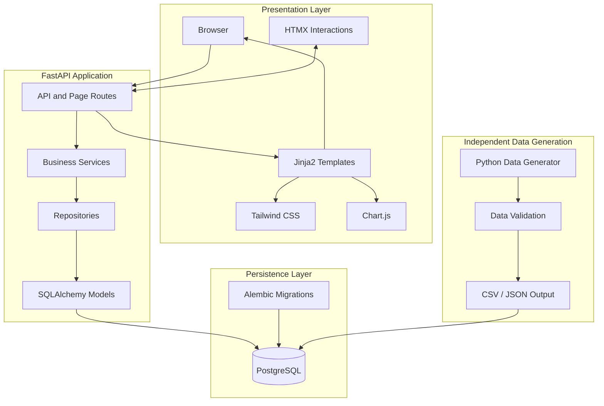
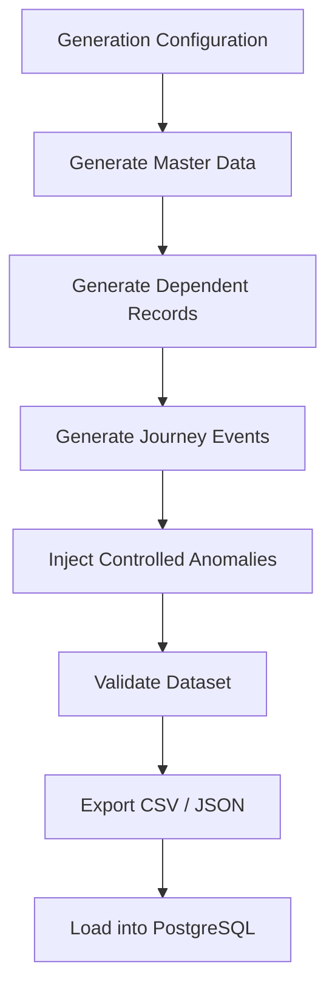

# JourneyIQ — System Architecture

**Document Version:** 0.2  
**Status:** Proposed Architecture  
**Project:** Customer Journey Analytics Platform  
**Architecture Style:** Modular Monolith  
**Development Approach:** Backend-First, Specification-Driven Development

---

# 1. Architecture Overview

## 1.1 Purpose

JourneyIQ is a customer journey analytics platform designed to collect, process, analyze, and visualize customer interactions across multiple channels.

The system connects events from web, mobile applications, support interactions, and purchase systems to reconstruct customer journeys, identify friction points, analyze conversion funnels, and expose operational anomalies.

The architecture must support:

- Large-scale synthetic event generation.
- Multi-channel customer journey reconstruction.
- Consent-aware identity resolution.
- Sessionization and funnel analysis.
- Purchase, payment, cart, and refund tracking.
- Support-assisted conversion analysis.
- Experiment assignment and exposure tracking.
- Data quality monitoring and anomaly investigation.
- Traceable and reproducible analytical outcomes.

## 1.2 Architectural Principles

The system follows these principles:

1. **Modular monolith:** Maintain one deployable backend with clearly separated business modules.
2. **Backend-first development:** Establish the data model, business logic, and API contracts before building dashboard interfaces.
3. **Data integrity:** Enforce relationships, constraints, and lifecycle rules at the appropriate application and database layers.
4. **Event traceability:** Preserve original events and maintain explicit records of important state transitions.
5. **Deterministic processing:** Identical inputs and processing versions should produce reproducible analytical results.
6. **Privacy by design:** Respect consent restrictions during identity resolution and analytics.
7. **Separation of concerns:** Keep data generation, persistence, business logic, and presentation responsibilities distinct.
8. **Simplicity:** Prefer understandable implementations over unnecessary infrastructure and abstractions.

---

# 2. Technology Stack

The following stack represents the intended architecture. Technologies marked as proposed should be confirmed before implementation.

| Layer | Technology | Responsibility | Decision status |
|---|---|---|---|
| Backend | FastAPI | HTTP routing, validation, application entry point | Intended |
| HTML rendering | Jinja2 | Server-side HTML templates | Confirmed |
| Dynamic interactions | HTMX | Partial page updates and asynchronous HTML requests | Proposed |
| Styling | Tailwind CSS | Responsive UI styling and design consistency | Proposed |
| Charts | Chart.js | Funnel, trend, and distribution visualizations | Proposed |
| Database | PostgreSQL | Persistent relational storage | Intended |
| ORM | SQLAlchemy | Database models and queries | Intended |
| Migrations | Alembic | Database schema versioning | Intended |
| Data generation | Python | Synthetic data generation | Intended |
| Data analysis | Pandas, NumPy | Data processing and analytical computations | Intended |
| Testing | Pytest | Unit, integration, and API testing | Proposed |
| API documentation | FastAPI OpenAPI | API schema and interactive documentation | Native capability |

## 2.1 Backend — FastAPI

FastAPI is responsible for:

- HTTP routing.
- Request validation.
- Response handling.
- Application services.
- Database interaction through dedicated layers.
- Server-side HTML rendering.
- API documentation.
- Error handling.

The backend is the central application layer.

## 2.2 Frontend — Jinja2

JourneyIQ will use server-rendered HTML rather than a separate React application.

Jinja2 is responsible for:

- Rendering HTML pages.
- Template inheritance.
- Reusable components.
- Displaying backend-provided data.
- Rendering conditional content.
- Generating HTML for dashboard sections.

The application will use a shared `base.html` layout to maintain consistent navigation, page structure, and styling.

## 2.3 Dynamic Interactions — HTMX

HTMX is the proposed solution for dynamic browser interactions without introducing a full frontend framework.

Examples:

- Refreshing dashboard metrics.
- Applying date filters.
- Updating funnel visualizations.
- Loading journey details.
- Searching customer records.
- Filtering anomaly tables.
- Expanding investigation details.

FastAPI will return HTML fragments when an HTMX request requires a partial page update.

This avoids introducing unnecessary frontend state management.

## 2.4 Styling — Tailwind CSS

Tailwind CSS is proposed for the application design system.

The interface should prioritize:

- Mobile-friendly layouts where appropriate.
- Clear information hierarchy.
- Consistent spacing and typography.
- Reusable visual patterns.
- Readable tables and analytical dashboards.
- Accessible color contrast.
- Responsive charts and visualizations.

The existing UI design skill provided to Antigravity should be inspected before implementation.

Its applicable design principles should be followed. React-specific dependencies or component patterns should not be introduced merely because they appear in the skill.

## 2.5 Charts — Chart.js

Chart.js is proposed for analytical visualizations.

Potential use cases:

- Funnel conversion rates.
- Conversion trends.
- Channel comparisons.
- Session distribution.
- Cart abandonment.
- Payment failure rates.
- Experiment performance.
- Journey friction distribution.

The backend should calculate or retrieve the required analytical data. Chart.js should primarily handle visualization.

## 2.6 Database — PostgreSQL

PostgreSQL will be the primary persistent data store.

It will store:

- Customer records.
- Sessions and journey events.
- Identity and consent records.
- Cart and order records.
- Payment attempts and refunds.
- Support interactions.
- Experiments and assignments.
- Journey outcomes.
- Audit events.
- Quarantined events.

The database will enforce primary keys, foreign keys, uniqueness, check constraints, and indexes where appropriate.

## 2.7 ORM and Migrations

**SQLAlchemy** will manage relational database interaction.

**Alembic** will manage schema migrations.

Database schema changes must be version-controlled through migrations rather than being applied through undocumented manual modifications.

---

# 3. High-Level System Architecture

JourneyIQ follows a modular monolith architecture.

The application has one primary backend deployment, with separate internal modules for different business responsibilities.

The synthetic data generator operates independently from the application runtime.



## 3.1 Request Flow

A typical dashboard request follows this sequence:

1. The user opens a dashboard page.
2. FastAPI receives the HTTP request.
3. The route calls the appropriate business service.
4. The service retrieves or calculates the required metrics.
5. The repository handles database queries.
6. The service returns the results.
7. FastAPI passes the results to a Jinja2 template.
8. Jinja2 renders the HTML.
9. The browser displays the completed page.

For dynamic interactions:

1. The user changes a filter or requests additional information.
2. HTMX sends an HTTP request.
3. FastAPI processes the request.
4. The relevant service retrieves updated information.
5. FastAPI renders a partial Jinja2 template.
6. HTMX replaces the appropriate section of the page.

---

# 4. Backend Architecture

## 4.1 Architecture Style

The backend follows a layered modular monolith.

The layers have distinct responsibilities:

| Layer | Responsibility |
|---|---|
| API / Routes | Accept HTTP requests and return responses |
| Schemas | Validate and structure input/output data |
| Services | Implement business rules and workflows |
| Repositories | Encapsulate database queries |
| Models | Define relational database entities |
| Core | Configuration, security, logging, shared utilities |
| DB | Database connections and session management |

## 4.2 Proposed Backend Structure

```text
backend/
├── app/
│   ├── api/
│   │   ├── routes/
│   │   │   ├── dashboard.py
│   │   │   ├── events.py
│   │   │   ├── sessions.py
│   │   │   ├── journeys.py
│   │   │   ├── funnels.py
│   │   │   ├── customers.py
│   │   │   ├── carts.py
│   │   │   ├── orders.py
│   │   │   ├── payments.py
│   │   │   ├── support.py
│   │   │   ├── experiments.py
│   │   │   ├── outcomes.py
│   │   │   ├── exceptions.py
│   │   │   └── health.py
│   │   └── dependencies.py
│   │
│   ├── core/
│   │   ├── config.py
│   │   ├── security.py
│   │   ├── logging.py
│   │   └── exceptions.py
│   │
│   ├── models/
│   │   ├── customer.py
│   │   ├── session.py
│   │   ├── event.py
│   │   ├── identity.py
│   │   ├── consent.py
│   │   ├── product.py
│   │   ├── cart.py
│   │   ├── order.py
│   │   ├── payment.py
│   │   ├── refund.py
│   │   ├── support.py
│   │   ├── experiment.py
│   │   ├── journey.py
│   │   ├── outcome.py
│   │   ├── audit.py
│   │   └── quarantine.py
│   │
│   ├── schemas/
│   ├── repositories/
│   ├── services/
│   ├── db/
│   │
│   ├── templates/
│   │   ├── base.html
│   │   ├── components/
│   │   ├── dashboard/
│   │   ├── funnels/
│   │   ├── journeys/
│   │   ├── customers/
│   │   ├── exceptions/
│   │   └── experiments/
│   │
│   ├── static/
│   │   ├── css/
│   │   ├── js/
│   │   └── images/
│   │
│   └── main.py
│
├── migrations/
├── tests/
├── requirements.txt
└── .env.example
```

This is a proposed target structure. Files should be introduced incrementally as their responsibilities become necessary.

## 4.3 Business Modules

The following modules define the major business responsibilities.

| Module | Responsibility |
|---|---|
| Customer | Customer records and customer-level information |
| Event | Event ingestion, validation, deduplication, and event history |
| Session | Sessionization and session lifecycle |
| Identity | Anonymous-to-known identity resolution |
| Consent | Consent history and analytics eligibility |
| Journey | Customer journey reconstruction |
| Funnel | Funnel stage progression and conversion analysis |
| Transaction | Cart, order, payment, and refund workflows |
| Support | Support tickets and lifecycle events |
| Experiment | Experiment configuration, assignment, and exposure |
| Outcome | Versioned journey and session outcomes |
| Data Quality | Anomaly detection and event quarantine |
| Audit | Append-only audit history |
| Dashboard | Aggregated metrics and dashboard queries |

Modules should communicate through explicit service interfaces rather than directly coupling unrelated business logic.

---

# 5. Domain and Data Architecture

## 5.1 Core Entities

JourneyIQ uses 24 primary domain entities.

| Category | Entities |
|---|---|
| Customer and identity | Customer, IdentityLink, ConsentRecord |
| Events and sessions | JourneyEvent, Session, EventQuarantine |
| Catalog | Page, Product |
| Cart and purchase | Cart, CartItem, CartItemEvent, Order, OrderItem, PaymentAttempt, Refund |
| Support | SupportTicket, SupportTicketEvent |
| Experiments | Experiment, ExperimentVariant, ExperimentAssignment, ExperimentExposure |
| Journey analytics | CustomerJourney, JourneyOutcome |
| Governance | AuditEvent |

## 5.2 Database Identity Strategy

The approved identifier strategy is:

- Internal UUID primary keys for relational integrity.
- Unique human-readable business identifiers for traceability and debugging.
- Foreign keys reference internal UUIDs.
- Business identifiers are not used as substitutes for relational foreign keys.

## 5.3 Event Architecture

JourneyEvent represents an immutable record of an observed interaction.

Each event should preserve relevant information such as:

- Event identifier.
- Customer or anonymous identity reference.
- Session reference where reliably available.
- Event type.
- Origin channel.
- Event timestamp.
- Ingestion timestamp.
- Source sequence where available.
- Idempotency or source event reference.
- Relevant event metadata.

Event occurrence time and ingestion time must remain separate.

The original event should not be overwritten during processing.

Derived classifications, including bot classification, must remain separate from immutable raw event information.

## 5.4 Sessionization

Sessionization is based on event occurrence timestamps.

Approved rules:

- A 30-minute inactivity threshold.
- A gap of 30 minutes or less remains in the same session.
- A gap greater than 30 minutes starts a new session.
- WEB and APP sessions remain separate.
- Authentication alone does not split a session.
- Support and purchase events require reliable explicit references for session association.
- Missing client instance identifiers are quarantined or marked unresolvable.
- Late-arriving events may change derived session boundaries.
- Raw events remain immutable.
- Session recomputation must be deterministic and version-aware.

## 5.5 Identity Resolution and Consent

Identity resolution must respect consent.

Approved rules:

- Only GRANTED consent permits anonymous-to-known identity stitching.
- DENIED and UNKNOWN consent do not permit stitching.
- Authentication alone does not authorize analytics identity linking.
- Conflicting identity links are quarantined.
- Repeated identical identity-link requests are idempotent.
- Consent withdrawal requires the applicable historical customer-level analytics to be excluded.
- Identity associations are effective-dated and version-aware.

## 5.6 Journey and Funnel Architecture

JourneyIQ supports two separate analytical scopes:

1. Session-level funnels.
2. Customer-journey-level funnels.

The primary funnel stages are:

1. SESSION_STARTED
2. PRODUCT_VIEWED
3. ADD_TO_CART
4. CHECKOUT_STARTED
5. PURCHASE_COMPLETED

Each session is counted once per stage.

Strict sequential progression is measured separately.

A purchase without a cart remains valid. The system must not fabricate missing funnel stages.

Customer journey attribution uses a seven-day window from the first eligible touch.

## 5.7 Transaction Architecture

The transactional domain includes:

- Cart.
- CartItem.
- CartItemEvent.
- Order.
- OrderItem.
- PaymentAttempt.
- Refund.

Important rules:

- Cart abandonment requires 24 hours of qualifying inactivity without a completed purchase.
- Multiple payment attempts may belong to the same order.
- PAYMENT_FAILED is a payment attempt status, not a terminal order status.
- Only one valid successful conversion is counted per cart.
- Price snapshots must be preserved.
- Refunds are represented explicitly.
- Purchase completion is authoritative from the purchase system.
- Duplicate purchase deliveries must not produce duplicate conversions.

## 5.8 Support Architecture

SupportTicket and SupportTicketEvent represent support interactions and their lifecycle.

Support-assisted conversion requires:

- A valid journey association.
- A support interaction occurring before purchase.
- A purchase within the seven-day attribution window.

Support assistance must not be represented as proof of causation.

## 5.9 Experiment Architecture

Experiment management includes:

- Experiment configuration.
- Variants.
- Assignment.
- Exposure.

Approved rules:

- Every experiment has at least two variants, including a control.
- Variant allocation totals 100%.
- Assignment is deterministic.
- Assignment and exposure are separate records.
- Pausing an experiment stops new assignments and exposures.
- Historical assignments and exposures remain preserved.
- Identity assignment is consent-aware.
- Experiment configuration and variant definitions are versioned.

## 5.10 Journey Outcomes

JourneyOutcome supports:

- SESSION scope.
- CUSTOMER_JOURNEY scope.

Outcome statuses:

- IN_PROGRESS
- CONVERTED
- NON_CONVERTED
- EXCLUDED

Conversion requires an authoritative purchase.

An open attribution window without purchase remains IN_PROGRESS.

An expired attribution window without purchase becomes NON_CONVERTED.

Cart abandonment and journey non-conversion are separate concepts.

Outcome calculations must be deterministic for the same inputs and processing version. Previous calculations must remain traceable.

---

# 6. Data Generation Architecture

## 6.1 Independent Generator

Synthetic data generation will be implemented in Python and remain logically independent from the FastAPI runtime.

The generator is responsible for creating realistic, relationally consistent datasets.

It should not contain dashboard-specific business logic or become tightly coupled to the application.

## 6.2 Target Data Volumes

| Data | Target volume |
|---|---:|
| Customers | 20,000 |
| Sessions | 100,000 |
| Journey events | 2,000,000 |

Other entity volumes should be generated through documented relationships and configurable distributions.

## 6.3 Generation Pipeline



## 6.4 Reproducibility

The generator must support:

- Fixed random seed.
- Configurable dataset sizes.
- Deterministic generation.
- Referential integrity validation.
- Duplicate detection.
- Lifecycle validation.
- Timestamp validation.
- Financial arithmetic validation.
- Generation metadata and manifests.

The initial generation manifest will be stored as JSON output files rather than a dedicated database entity.

## 6.5 Mandatory Anomalies

The generator must inject four documented anomalies:

1. Event ingestion order differs from occurrence order.
2. Incorrect anonymous identity merge.
3. Duplicate conversion counting.
4. Bot traffic mixed with customer behaviour.

These anomalies must be traceable and suitable for analytical investigation.

---

# 7. API Architecture

## 7.1 API Versioning

The API will use versioned routes:

`/api/v1/`

The backend will expose JSON APIs where appropriate and HTML page routes for the Jinja2 interface.

These two response types should be clearly separated.

## 7.2 Proposed API Endpoints

| Endpoint | Responsibility |
|---|---|
| `/api/v1/dashboard` | Dashboard metrics |
| `/api/v1/events` | Event ingestion and retrieval |
| `/api/v1/sessions` | Session records and analysis |
| `/api/v1/journeys` | Customer journey retrieval |
| `/api/v1/funnels` | Funnel analytics |
| `/api/v1/customers` | Customer information |
| `/api/v1/carts` | Cart analytics |
| `/api/v1/orders` | Order information |
| `/api/v1/payments` | Payment attempts |
| `/api/v1/support` | Support interactions |
| `/api/v1/experiments` | Experiment analysis |
| `/api/v1/outcomes` | Journey outcomes |
| `/api/v1/exceptions` | Data quality exceptions |
| `/api/v1/health` | Application health |

These are proposed endpoint responsibilities, not finalized API contracts.

Exact HTTP methods, request schemas, response schemas, pagination, filtering, and error formats must be defined in a separate API contract document before implementation.

## 7.3 HTML Page Routes

The user-facing application will have server-rendered routes such as:

- `/dashboard`
- `/funnels`
- `/journeys`
- `/customers`
- `/exceptions`
- `/experiments`

These routes render Jinja2 templates.

---

# 8. Frontend Architecture

## 8.1 Page Structure

The initial interface will contain five primary views.

| View | Main functionality |
|---|---|
| Overview Dashboard | Core KPIs, conversion trends, channel performance |
| Funnel Analysis | Stage progression, drop-offs, conversion rates |
| Journey Investigation | Individual journey timelines and friction points |
| Data Quality | Anomalies, quarantined events, data quality metrics |
| Experiments | Experiment status, assignment, exposure, performance |

## 8.2 Template Inheritance

`base.html` will provide the shared application layout.

Individual pages will extend the base template.

Reusable components will be stored in `templates/components/`.

Examples include:

- Navigation.
- Sidebar.
- Metric cards.
- Tables.
- Filters.
- Pagination.
- Status indicators.
- Chart containers.

## 8.3 Dynamic Updates

HTMX will be used for interactions that benefit from partial HTML updates.

Examples:

- Applying dashboard filters.
- Refreshing a funnel result.
- Loading journey details.
- Searching customer records.
- Filtering exception records.

The server remains responsible for generating the resulting HTML.

## 8.4 Visualization Flow

The visualization process will follow:

1. Browser requests a dashboard page.
2. FastAPI retrieves analytics through services.
3. Jinja2 renders the page.
4. Chart.js receives the required chart data.
5. The browser renders the visualization.

For large datasets, the backend should return aggregated analytical results rather than sending millions of raw events to the browser.

---

# 9. Data Processing and Analytics Architecture

The analytics pipeline will operate on persisted event and transactional data.

The intended processing sequence is:

1. Validate incoming or generated events.
2. Preserve raw event history.
3. Detect invalid or conflicting events.
4. Quarantine events that cannot be safely processed.
5. Deduplicate analytical counting using authoritative identifiers.
6. Reconstruct sessions.
7. Resolve identities using applicable consent.
8. Reconstruct customer journeys.
9. Calculate funnel metrics.
10. Calculate attribution and outcomes.
11. Produce dashboard-ready aggregates.

Derived analytical outputs must retain processing-version information where reproducibility requires it.

The system should avoid recalculating the entire two-million-event dataset for every dashboard request.

A suitable aggregation and caching strategy should be selected after representative workload testing.

---

# 10. Security and Privacy Architecture

Security and privacy must be considered throughout the system.

## 10.1 Configuration and Secrets

- Store database credentials and secrets in environment variables.
- Maintain `.env.example` without actual credentials.
- Never commit real `.env` files.
- Use safe configuration defaults.

## 10.2 Input Validation

- Validate request payloads through Pydantic schemas.
- Validate identifiers and lifecycle transitions.
- Enforce database constraints.
- Handle malformed events explicitly.
- Avoid trusting client-provided identity or authorization claims.

## 10.3 Identity and Consent

- Enforce consent rules in backend services.
- Never rely on frontend controls to enforce consent.
- Preserve consent history.
- Prevent unauthorized identity stitching.
- Quarantine conflicting identity relationships.

## 10.4 Database Security

- Use parameterized queries through SQLAlchemy.
- Apply least-privilege database access.
- Avoid exposing internal database errors to users.
- Keep sensitive configuration outside source control.

## 10.5 Auditability

Important operations should generate traceable audit records.

Audit history should be append-only at the application level.

---

# 11. Performance and Scalability Considerations

The platform targets approximately 100,000 sessions and 2 million journey events.

Performance decisions must be based on measurement rather than assumptions.

Important considerations:

- Index frequently filtered columns.
- Use pagination for large result sets.
- Avoid loading all events into application memory.
- Use database aggregation for appropriate analytical queries.
- Separate raw event storage from derived analytical outputs.
- Avoid repeated full-dataset calculations during dashboard requests.
- Use bulk operations for synthetic data ingestion.
- Profile expensive queries.
- Introduce caching only where measurements justify it.

Potential indexes include:

- JourneyEvent event_timestamp.
- JourneyEvent ingestion_timestamp.
- JourneyEvent event_type.
- JourneyEvent session_id.
- JourneyEvent customer_id.
- Session customer_id.
- Session started_at.
- Order customer_id.
- Order purchase_confirmed_at.
- IdentityLink anonymous_id.
- IdentityLink customer_id.
- EventQuarantine resolution_status.

Final indexes must be validated against actual query patterns.

The system should initially remain a single deployable modular monolith. Distributed processing and microservices are outside the initial scope.

---

# 12. Testing Architecture

Testing will be performed at multiple levels.

## 12.1 Unit Testing

Test isolated business rules, including:

- Sessionization boundaries.
- Consent-aware identity resolution.
- Funnel stage progression.
- Cart abandonment.
- Payment retry handling.
- Support-assisted attribution.
- Deterministic experiment assignment.
- Journey outcome calculations.

## 12.2 Integration Testing

Test interactions between:

- Services and repositories.
- Services and PostgreSQL.
- Database constraints and migrations.
- Event ingestion and quarantine.
- Identity resolution and consent.
- Transaction records and journey outcomes.

## 12.3 API Testing

Test:

- Valid requests.
- Invalid payloads.
- Missing records.
- Duplicate submissions.
- Unauthorized operations where applicable.
- Pagination and filters.
- Error responses.

## 12.4 Data Validation Testing

Validate:

- Primary-key uniqueness.
- Foreign-key integrity.
- Valid enumerations.
- Timestamp consistency.
- Financial arithmetic.
- Lifecycle transitions.
- Deterministic generation.
- Mandatory anomaly presence.

---

# 13. Repository Structure

The proposed root-level repository structure is:

```text
JourneyIQ/
│
├── backend/
│   ├── app/
│   ├── migrations/
│   ├── tests/
│   └── requirements.txt
│
├── data-generation/
│   ├── notebooks/
│   ├── generator/
│   ├── validation/
│   └── output/
│
├── docs/
│   ├── PRD.md
│   ├── SUCCESS_CRITERIA.md
│   ├── ARCHITECTURE.md
│   ├── DATA_DICTIONARY.md
│   ├── BUSINESS_RULES.md
│   └── DECISIONS.md
│
├── specs/
│
├── tests/
│
├── .env.example
├── .gitignore
└── README.md
```

The existing `frontend/` directory is not part of the proposed final architecture because the frontend will be integrated into the FastAPI application.

However, its removal is not authorized by this architecture document. Inspect it first and obtain explicit approval before deleting or moving anything.

The exact placement of shared tests and backend-specific tests should be finalized during implementation planning.

---

# 14. Development Strategy

JourneyIQ will be developed using a backend-first workflow.

The intended order is:

1. Finalize requirements and acceptance criteria.
2. Finalize architecture and architectural decisions.
3. Complete the data dictionary.
4. Define API contracts.
5. Establish database schema and migrations.
6. Implement core backend modules.
7. Build and validate synthetic data generation.
8. Test backend functionality.
9. Implement server-rendered Jinja2 pages.
10. Add HTMX interactions and visualizations.
11. Perform end-to-end testing.
12. Prepare documentation and deployment instructions.

The frontend should consume stable backend behaviour rather than driving backend design through ad hoc UI requirements.

---

# 15. Architectural Decisions

| ID | Decision | Status |
|---|---|---|
| ADR-001 | Use a modular monolith | Proposed |
| ADR-002 | Use FastAPI as the backend framework | Intended |
| ADR-003 | Use Jinja2 instead of React | Confirmed |
| ADR-004 | Use HTMX for partial page updates | Proposed |
| ADR-005 | Use Tailwind CSS for styling | Proposed |
| ADR-006 | Use Chart.js for visualizations | Proposed |
| ADR-007 | Use PostgreSQL as the primary database | Intended |
| ADR-008 | Use SQLAlchemy for ORM/database interaction | Intended |
| ADR-009 | Use Alembic for migrations | Intended |
| ADR-010 | Keep the synthetic data generator independent | Intended |
| ADR-011 | Use deterministic, version-aware analytical processing | Intended |
| ADR-012 | Follow backend-first development | Intended |
| ADR-013 | Use UUID primary keys and unique business identifiers | Confirmed |
| ADR-014 | Preserve immutable raw events and append-only history | Confirmed |

Detailed rationale and consequences should be maintained in `docs/DECISIONS.md`.

---

# 16. Open Architectural Decisions

The following decisions must be resolved before or during implementation planning.

| ID | Question | Why it matters |
|---|---|---|
| OPEN-001 | Should HTMX be adopted as the dynamic interaction layer? | Determines frontend interaction strategy |
| OPEN-002 | Should Tailwind CSS be adopted in the proposed setup? | Determines styling and asset workflow |
| OPEN-003 | Should Chart.js be the visualization library? | Determines chart implementation |
| OPEN-004 | Should database access use synchronous or asynchronous SQLAlchemy? | Affects service and repository design |
| OPEN-005 | Should PostgreSQL run locally or through Docker? | Affects development setup |
| OPEN-006 | Which analytical outputs should be persisted versus calculated on demand? | Affects query performance |
| OPEN-007 | What aggregation strategy is appropriate for two million events? | Affects dashboard responsiveness |
| OPEN-008 | What authentication and authorization scope is required for the hackathon? | Affects security implementation |
| OPEN-009 | What exact performance thresholds should be used? | Establishes measurable performance acceptance criteria |
| OPEN-010 | What are the expected synthetic anomaly volumes? | Ensures reproducible data quality testing |

These questions should be resolved explicitly. Do not silently convert proposed choices into approved architectural decisions.

---

# 17. Initial Scope Boundaries

The initial implementation prioritizes:

- A working end-to-end customer journey analytics workflow.
- Reproducible synthetic data.
- Correct session and identity reconstruction.
- Funnel and conversion analysis.
- Transaction and support journey analysis.
- Experiment tracking.
- Data quality and anomaly investigation.
- A functional analytical dashboard.

The initial architecture does not require:

- Microservices.
- Kubernetes.
- Distributed event streaming infrastructure.
- A separate React application.
- Complex frontend state management.
- Production-scale distributed analytics infrastructure.

These may be considered in future versions if the requirements justify them.

---

# 18. Definition of Architectural Completion

The architecture is considered ready for implementation when:

- The technology stack is finalized.
- Domain responsibilities are clearly separated.
- The 24 entities are represented consistently.
- The database relationship strategy is documented.
- Event and identity-processing rules are understood.
- Backend and frontend responsibilities are clear.
- API contracts are defined.
- Security and privacy boundaries are documented.
- Open decisions have been resolved or explicitly deferred.
- The implementation sequence is agreed upon.

**End of Architecture Document**